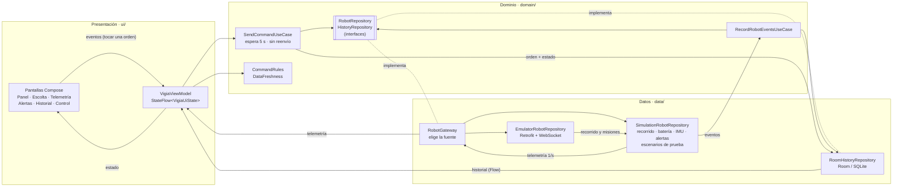
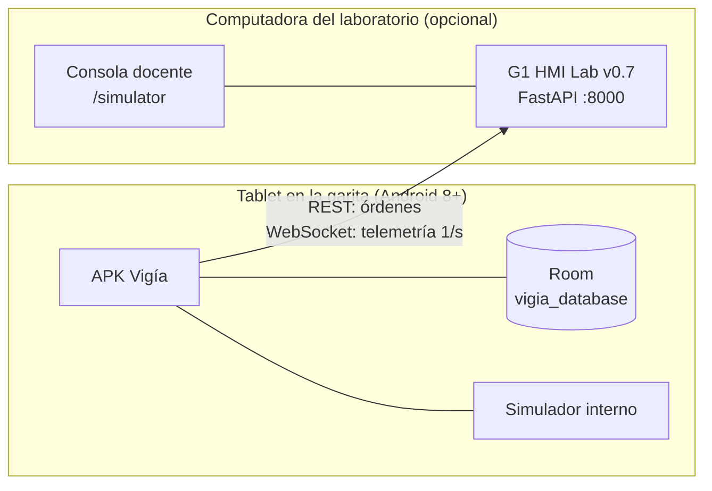

# Arquitectura de Vigía

MVVM con capas de Clean Architecture. La UI observa un único estado (`StateFlow<VigiaUiState>`) y envía eventos
al `VigiaViewModel`; nunca accede al simulador directamente. Un `RobotRepository` desacopla telemetría, comandos y
eventos de su implementación.

## Flujo de datos

1. El guardia toca una orden. La pantalla llama al `VigiaViewModel`, que la marca **Pendiente** y bloquea el botón.
2. `SendCommandUseCase` la envía al `RobotRepository` y espera como máximo 5 s:
   **Confirmada**, **Rechazada** (con motivo y código) o **Sin respuesta**. La orden queda en el historial.
3. El robot (simulado o emulado) publica una muestra de telemetría por segundo. El ViewModel calcula la
   antigüedad del dato cada segundo, aunque no lleguen muestras: así detecta la desconexión.
4. Los hitos de la escolta y las alertas llegan como eventos y `RecordRobotEventsUseCase` los guarda en Room.
5. Historial y resumen se leen siempre de Room: funcionan sin conexión.

## Topología

- **Sin red** (por defecto): la app usa el simulador interno. No necesita robot, servidor ni internet.
- **Con el emulador de la cátedra**: la tablet y la computadora en la misma red local (desde el emulador de
  Android, `http://10.0.2.2:8000`). El tráfico es HTTP sin cifrar porque el emulador no ofrece TLS; la app no se
  comunica con ningún otro servidor.

## Responsabilidades

| Capa | Paquete | Qué contiene |
|---|---|---|
| Presentación | `ui/`, `ui/screens/`, `ui/components/`, `ui/theme/` | Pantallas, componentes reutilizables (chip de estado, botón de orden, botón de mantener 2 s, tarjeta de dato, plano del recorrido), tokens del Figma, `AppShell` (navegación y avisos globales), `VigiaViewModel`. |
| Dominio | `domain/model/`, `domain/repository/`, `domain/usecase/` | Modelos (telemetría, misión, alertas, órdenes), interfaces de repositorios, reglas de habilitación, antigüedad del dato, casos de uso. No depende de Android. |
| Datos | `data/simulation/`, `data/remote/`, `data/local/`, `data/RobotGateway.kt` | Simulador del G1, cliente del emulador, Room. |
| DI | `di/AppContainer.kt`, `VigiaApplication.kt` | Inyección manual. El contenedor vive en la Application: el simulador sigue corriendo si la Activity se recrea. |

## Pruebas

`./gradlew testDebugUnitTest` (18 pruebas):

- `CommandRulesTest`: condiciones de habilitación de cada orden y antigüedad del dato.
- `SendCommandUseCaseTest`: confirmada, rechazada y sin respuesta a los 5 s, sin reenvío.
- `SimulationRobotRepositoryTest`: escolta completa con tiempo virtual, espera en el cruce, visitante rezagado,
  desconexión y orden rechazada.
- `EmulatorContractTest`: lectura de la telemetría y de las respuestas reales del G1 HMI Lab.
